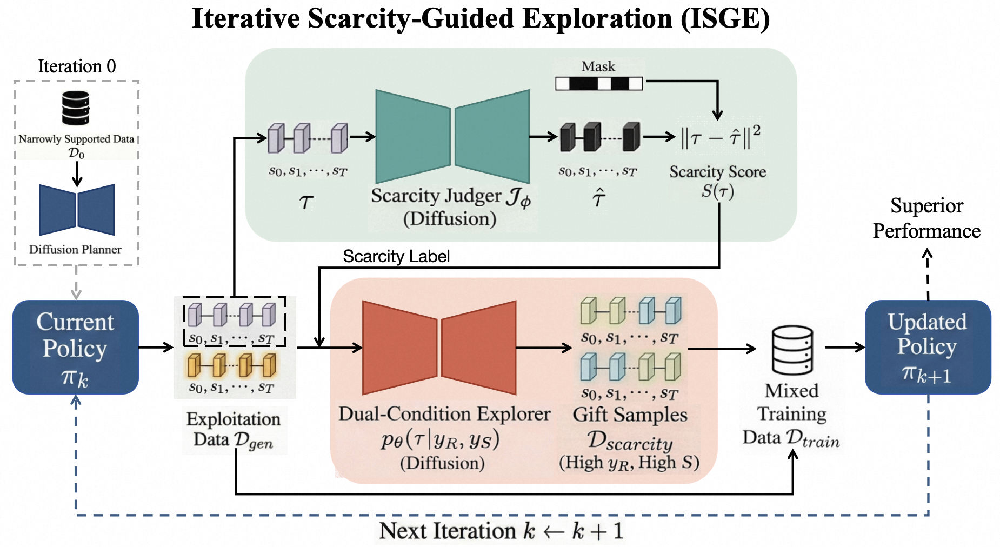

# ISGE: Iterative Scarcity-Guided Exploration

Reference implementation for **Iterative Scarcity-Guided Exploration: Bootstrapping Generative Auto-bidding from Narrow Support** (NeurIPS 2026).

ISGE improves a generative bidding policy through iterative exploration. A **Judger** measures trajectory scarcity through reconstruction error, and an **Explorer** combines return and scarcity guidance to collect new experience beyond the current data support. The bidding policy is then updated using the collected experience.



<sub>Due to company security restrictions, trained policy checkpoints and associated internal artifacts are not included. This release provides the core method and reference training and integration scripts.</sub>

## Core components

| Component | Implementation | Description |
|---|---|---|
| Diffusion Planner | [`DFUSER.py`](strategy_train_env/bidding_train_env/baseline/dd/DFUSER.py) | Return-conditioned state-trajectory generation with an inverse dynamics head for bidding actions. |
| Scarcity Judger | [`DFUSER.py`](strategy_train_env/bidding_train_env/baseline/dd/DFUSER.py), with `returns_condition=False` | Unconditional trajectory reconstruction using the same diffusion backbone. |
| Scarcity scoring | [`apply_judger.py`](strategy_train_env/judger_explorer/apply_judger.py) | Fixed-level corruption and reconstruction, followed by a weighted absolute residual over selected state features. |
| Explorer | [`DFUSER_SC.py`](strategy_train_env/bidding_train_env/baseline/dd/DFUSER_SC.py) | Separate return and scarcity conditions with dual classifier-free guidance. |
| Trajectory datasets | [`dataset.py`](strategy_train_env/bidding_train_env/baseline/dd/dataset.py) | Trajectory loading, normalization, padding, return calculation, and dual-condition labels. |

The Judger scores reconstruction errors on remaining budget, historical mean bid, and recent mean bid. Scores are log-transformed and normalized before being used as scarcity labels.

The Explorer combines three noise predictions during reverse diffusion:

```text
epsilon = epsilon_uncond
        + w_return   * (epsilon_return   - epsilon_uncond)
        + w_scarcity * (epsilon_scarcity - epsilon_uncond)
```

Generated state trajectories are translated into bidding multipliers by the inverse dynamics head. For each advertising opportunity, the bid is the multiplier times its predicted value.

## File structure

```text
.
├── main_test.py                         # Evaluation / collection entry point
├── run/
│   └── run_test.py                      # Auction simulation and logging
└── strategy_train_env/
    ├── main/
    │   └── main_decision_diffuser.py    # Planner training entry point
    ├── run/
    │   └── run_decision_diffuser.py     # Planner training loop
    ├── judger_explorer/
    │   ├── run_judger.py               # Unconditional Judger training
    │   ├── apply_judger.py             # Scarcity scoring and analysis
    │   └── run_explorer.py             # Dual-condition Explorer training
    └── bidding_train_env/
        ├── baseline/dd/
        │   ├── DFUSER.py               # Planner / Judger model
        │   ├── DFUSER_SC.py            # Explorer model
        │   └── dataset.py              # Trajectory datasets
        ├── common/
        │   └── utils.py                # Shared preprocessing utilities
        ├── strategy/
        │   └── dd_bidding_strategy.py  # Bidding interface adapter
        └── train_data_generator/
            ├── log_data_generator_parallel.py
            ├── multiplayer_data_generator.py
            └── singleplayer_data_generator.py
```

The three data-generator scripts convert auction logs into training trajectories using different input-directory and parallel-processing arrangements. They do not generate exploratory plans themselves.

## Workflow

1. **Train the bidding policy.** Use `run_decision_diffuser.py` to train a return-conditioned Planner on the available trajectory data.
2. **Collect exploitation experience.** Execute the policy in the auction environment and convert the interaction logs into training trajectories.
3. **Train the Judger and label trajectories.** Use `run_judger.py` and `apply_judger.py` to obtain scarcity labels for the current exploitation data.
4. **Train the Explorer.** Use `run_explorer.py` to train the dual-condition model on return- and scarcity-labeled trajectories.
5. **Collect exploration experience and update the policy.** Execute the Explorer, process the resulting interaction logs, and train the next Planner on the combined exploitation and exploration data. Repeat the process for subsequent iterations.

The scripts expose individual stages; iteration scheduling and dataset selection are managed by the user. Training data should contain the state, action, reward, timestep, CPA constraint, and trajectory-level cost fields expected by `dataset.py`. The reference models use a 48-step horizon, 16-dimensional states, and a one-dimensional bidding multiplier.

Use matching normalization statistics when moving between training, scoring, and inference. Each model checkpoint should be paired with its corresponding scaler file.

## AuctionNet integration

The auction environment and bidding interfaces follow [AuctionNet](https://github.com/alimama-tech/AuctionNet). Refer to its official repository for environment setup and public data resources. The directories in this release follow the AuctionNet layout for adapting the components to that environment.

To use these scripts, prepare the required data and models, update the paths, and adapt the bidding and logging interfaces to your AuctionNet environment.

The bidding adapter currently defaults to a simulator-assisted cost-matching diagnostic (`cheat=True`); inverse-dynamics action execution is selected with `cheat=False`. This diagnostic and the planning-trace outputs are retained from experimental analysis and should be configured separately from the core ISGE training workflow.
